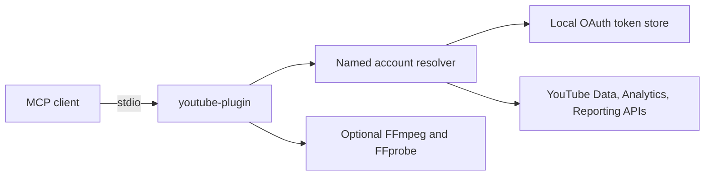

<div align="center">

# YouTube Plugin

**Your YouTube channels, publishing workflow, analytics, and local media tools — from one MCP server.**

[](https://nodejs.org/)
[](https://modelcontextprotocol.io/)
[](#tool-catalog)
[](LICENSE)

One local stdio server. Multiple named YouTube accounts. Typed tools for the official YouTube APIs, plus optional FFmpeg media processing.

[Quick start](#60-second-start) · [Features](#what-you-can-do) · [Tool catalog](#tool-catalog) · [Documentation](#documentation)

</div>

---

## 60-second start

```bash
git clone https://github.com/saksham1991999/youtube-plugin.git
cd youtube-plugin
npm ci && npm run build
```

Set OAuth credentials, then authorize your first channel:

```bash
export GOOGLE_CLIENT_ID="your-client-id.apps.googleusercontent.com"
export GOOGLE_CLIENT_SECRET="your-client-secret"
npm run auth -- personal
```

Add the compiled server to your MCP client:

```json
{
  "mcpServers": {
    "youtube": {
      "command": "node",
      "args": ["/absolute/path/to/youtube-plugin/dist/index.js"],
      "env": {
        "GOOGLE_CLIENT_ID": "your-client-id",
        "GOOGLE_CLIENT_SECRET": "your-client-secret"
      }
    }
  }
}
```

Enable the YouTube Data API v3 and YouTube Analytics API in your Google Cloud project. Enable the YouTube Reporting API if you use reporting jobs. See [OAuth setup](docs/AUTH.md) for scopes and account selection.

## What you can do

| Area | Capabilities |
|---|---|
| **Channels** | Read channel details, update branding, upload banners, configure watermarks and channel sections |
| **Publishing** | Upload videos, schedule publication, edit metadata/localizations, and set custom thumbnails |
| **Captions** | List, upload, update, download, and delete caption tracks |
| **Community** | Read and moderate comments, manage subscriptions, ratings, memberships, and live chat |
| **Playlists** | Create, update, reorder, and manage playlist videos |
| **Analytics** | Query channel/video reports, retention, traffic sources, demographics, devices, and content types |
| **Live** | Manage broadcasts and streams, bind them, and moderate chat |
| **Local media** | Mix audio, normalize loudness, trim video, burn subtitles, inspect media, and extract thumbnail frames |

<details>
<summary><strong>How it fits together</strong></summary>



Every YouTube tool accepts an optional `account` alias. If you have one account, it is selected automatically. If you have multiple, specify the alias or set a default with `accounts_set_default`. The server refuses to guess when multiple accounts exist and no default is set.

</details>

## Tool catalog

Tool names use the `youtube_` prefix except for account utilities. The MCP server registers **97 individually typed tools**.

<details>
<summary><strong>Account utilities</strong> · 8 tools</summary>

`accounts_list`, `accounts_status`, `accounts_begin_auth`, `accounts_complete_auth`, `accounts_set_default`, `accounts_remove`, `youtube_quota_status`, `youtube_doctor`

</details>

<details>
<summary><strong>Core channel, video, playlist, comment, and search tools</strong> · 21 tools</summary>

`youtube_get_channel`, `youtube_update_channel`, `youtube_list_videos`, `youtube_get_video`, `youtube_update_video`, `youtube_delete_video`, `youtube_upload_video`, `youtube_set_thumbnail`, `youtube_set_thumbnail_from_file`, `youtube_list_playlists`, `youtube_create_playlist`, `youtube_update_playlist`, `youtube_add_to_playlist`, `youtube_remove_from_playlist`, `youtube_delete_playlist`, `youtube_list_comments`, `youtube_reply_to_comment`, `youtube_delete_comment`, `youtube_search_youtube`, `youtube_list_captions`, `youtube_list_categories`

</details>

<details>
<summary><strong>Publishing workflows, captions, and comment tools</strong> · 11 tools</summary>

`youtube_schedule_video`, `youtube_list_caption_tracks`, `youtube_upload_caption_track`, `youtube_update_caption_track`, `youtube_download_caption_track`, `youtube_delete_caption_track`, `youtube_moderate_comment`, `youtube_list_comment_replies`, `youtube_update_comment`, `youtube_add_top_level_comment`, `youtube_move_playlist_item`

</details>

<details>
<summary><strong>Analytics and reporting</strong> · 13 tools</summary>

`youtube_get_analytics`, `youtube_get_top_videos`, `youtube_get_channel_analytics`, `youtube_get_video_audience_retention`, `youtube_get_traffic_source_report`, `youtube_get_audience_demographics_report`, `youtube_get_device_and_os_report`, `youtube_get_content_type_report`, `youtube_list_reporting_report_types`, `youtube_create_reporting_job`, `youtube_list_reporting_jobs`, `youtube_delete_reporting_job`, `youtube_list_reporting_job_reports`

</details>

<details>
<summary><strong>Live streaming</strong> · 14 tools</summary>

`youtube_list_live_broadcasts`, `youtube_create_or_update_live_broadcast`, `youtube_delete_live_broadcast`, `youtube_transition_live_broadcast`, `youtube_list_live_streams`, `youtube_create_or_update_live_stream`, `youtube_delete_live_stream`, `youtube_bind_live_broadcast`, `youtube_list_live_chat_messages`, `youtube_send_live_chat_message`, `youtube_delete_live_chat_message`, `youtube_insert_live_chat_ban`, `youtube_delete_live_chat_ban`, `youtube_list_super_chat_events`

</details>

<details>
<summary><strong>Community and discovery</strong> · 15 tools</summary>

`youtube_list_subscriptions`, `youtube_subscribe_to_channel`, `youtube_unsubscribe_from_channel`, `youtube_list_channel_activities`, `youtube_list_membership_levels`, `youtube_list_channel_members`, `youtube_list_i18n_languages`, `youtube_list_i18n_regions`, `youtube_get_video_ratings`, `youtube_rate_video`, `youtube_list_video_abuse_report_reasons`, `youtube_report_video_abuse`, `youtube_list_live_chat_moderators`, `youtube_add_live_chat_moderator`, `youtube_remove_live_chat_moderator`

</details>

<details>
<summary><strong>Local media</strong> · 6 tools</summary>

`youtube_probe_media`, `youtube_mux_audio`, `youtube_normalize_loudness`, `youtube_extract_thumbnail`, `youtube_burn_subtitles`, `youtube_trim_clip`

</details>

<details>
<summary><strong>Channel branding</strong> · 7 tools</summary>

`youtube_upload_channel_banner`, `youtube_set_channel_watermark`, `youtube_unset_channel_watermark`, `youtube_list_channel_sections`, `youtube_create_channel_section`, `youtube_update_channel_section`, `youtube_delete_channel_section`

</details>

<details>
<summary><strong>Video localization</strong> · 2 tools</summary>

`youtube_get_video_localizations`, `youtube_update_video_localizations`

</details>

See [API coverage and limitations](docs/API-COVERAGE.md) for method-level notes and unsupported operations.

## Example calls

```text
youtube_list_videos({ account: "brand", maxResults: 10 })

youtube_upload_video({
  account: "brand",
  filePath: "/videos/launch.mp4",
  title: "Product launch",
  privacyStatus: "private",
  publishAt: "2026-11-01T17:00:00Z"
})

youtube_upload_caption_track({
  account: "brand",
  videoId: "VIDEO_ID",
  filePath: "/captions/launch.en.srt",
  language: "en",
  name: "English"
})

youtube_set_thumbnail_from_file({
  account: "brand",
  videoId: "VIDEO_ID",
  filePath: "/images/launch.png"
})
```

Permanently destructive actions require an explicit confirmation. Video and playlist deletion require the exact current title.

## Accounts and privacy

Authorize more channels under separate aliases:

```bash
npm run auth -- personal
npm run auth -- brand
```

Credentials are stored per account under `~/.config/youtube-plugin/accounts/` with restricted permissions. Override the location with `YOUTUBE_PLUGIN_CONFIG_DIR`; select a default account with `YOUTUBE_PLUGIN_ACCOUNT`. Existing `YOUTUBE_MCP_CONFIG_DIR`, `YOUTUBE_MCP_ACCOUNT`, and `YOUTUBE_MCP_TOOLSET` environment variables remain supported as compatibility fallbacks.

The optional `youtube.channel-memberships.creator` OAuth scope is not requested by default. Opt in only if you need membership tools:

```bash
npm run auth -- brand --memberships
```

Monetary analytics also require YouTube Partner Program eligibility. Review [OAuth scopes and storage](docs/AUTH.md).

## Local media pipeline

Install FFmpeg and FFprobe to enable the local media tools. Configure custom executable paths with `FFMPEG_PATH` and `FFPROBE_PATH`. The tools use absolute local paths, do not invoke a shell, and require `overwrite: true` to replace existing output files.

YouTube does not expose an API for adding Audio Library music or editing an uploaded video's audio. `youtube_mux_audio` creates a new local file that you can upload. Sidechain ducking follows activity in the original audio track; it is not speech detection. See [media tool details](docs/MEDIA.md).

## Toolsets and quota

Set `YOUTUBE_PLUGIN_TOOLSET` to `full` (default), `core`, `router`, or a comma-separated tool allowlist. The old `YOUTUBE_MCP_TOOLSET` variable remains a fallback.

`youtube_quota_status` reports a local estimate, not authoritative project usage. Google maintains separate daily call limits for `search.list` and `videos.insert`, plus a shared unit quota for other Data API calls. Check your live usage in [Google Cloud Console](https://console.cloud.google.com/iam-admin/quotas).

## Development

```bash
npm ci
npm run typecheck
npm run lint
npm test
```

Tests use temporary credential directories and do not call live Google APIs. Local media tools require FFmpeg only when invoked.

## Documentation

- [OAuth, account aliases, and scopes](docs/AUTH.md)
- [API coverage and limitations](docs/API-COVERAGE.md)
- [Local media tools](docs/MEDIA.md)

<div align="center">

MIT License · Built for the Model Context Protocol

</div>
